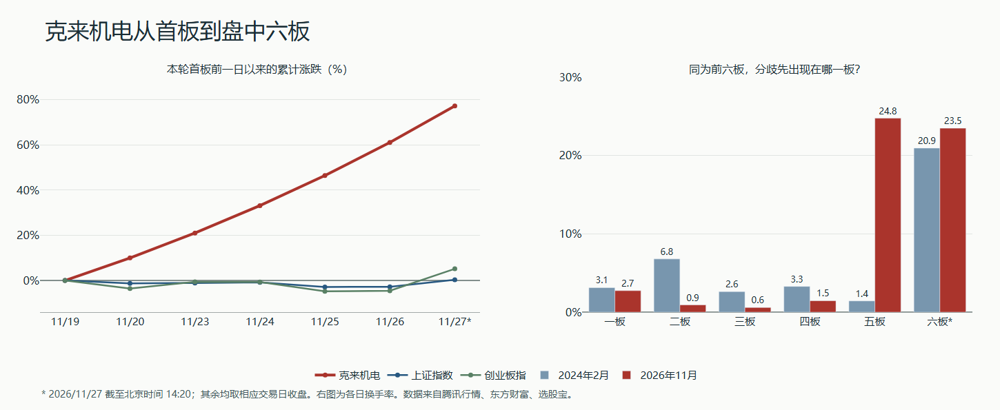

# “9·24”行情对照与克来机电六板复盘

## 11 月 27 日收盘更新与 11 月 30 日预案

**周一空仓先看第一次回落。克来机电看高位接力，骏亚科技看 PCB 领涨股，崇达技术是有条件的交易候选。** 周五收盘，沪指报 3606.49 点（+3.73%），创业板指涨 11.61%，科创 50 涨 15.07%。沪深北全市场成交 20173 亿元，较上一日放量 6913 亿元，超过 5300 只股票上涨。东方财富收盘涨停池有 417 只，炸板池有 41 只。417 只里有 388 只首板、22 只二板、3 只三板、3 只四板、0 只五板、1 只六板。按当日收盘价不超过 30 元筛选有 231 只，其中 204 只是首板。[全市场收评](https://wap.cj.sina.cn/pc/7x24/5242596) · [收盘及逐股统计底表](./数据核验/九二四涨停逐股对照与2026-11-27收盘.json)

### 前两天的线索

11 月 25 日的盘中原记已点到克来、东方海洋，并在医药和消费两条线上追问是否有同板块跟随。当天盘后预案还提出观察光通信向 PCB 扩散和高位接力。26 日，克来结束三个一字板，在 24.76% 换手、三次开板后封住五板，中京电子冲六失败。到 26 日收盘，已有充分理由把克来列为最高板观察股，并单列“若次日放量普涨，跟踪哪些首板在消息前就已走强”的预案。此前复盘分别写了连板和题材，却漏掉两者同时发生时的应对。可找回的 26 日原图是神驰机电两处红框日 K；关于“9·24 发酵、500 个涨停”的前两天原图或逐字原话尚未核实。[25 日讨论原记](./2026-11-25.md) · [25 日预案](./预案/2026-11-25.json) · [26 日截图验证](./形态验证/神驰机电红框日K验证.md)

### 2024 年两次数百股涨停后，原来的股票去了哪里

按选股宝沪深涨停池和证券代码逐日去重，9 月 24、25、26、27 日的收盘涨停数分别为 97、66、150、135。**启动后第一次超过 500 只是 9 月 30 日**。下表将前一天同一批股票追踪到次日收盘。不同供应商的市场范围不同，例如《中国证券报》报道 10 月 8 日全 A 有 791 只涨停。以下交集统一采用同一来源。[9 月 30 日名单](https://flash-api.xuangubao.cn/api/pool/detail?pool_name=limit_up&date=2024-09-30) · [10 月 8 日名单](https://flash-api.xuangubao.cn/api/pool/detail?pool_name=limit_up&date=2024-10-08) · [10 月 9 日名单](https://flash-api.xuangubao.cn/api/pool/detail?pool_name=limit_up&date=2024-10-09) · [中国证券报 10 月 9 日头版](https://epaper.cs.com.cn/zgzqb/images/2024-10/09/A01/zqDB0109.pdf)

| 前一日 → 下一交易日 | 两日涨停池总数 | 原来那批继续封板 | 次日新进池 | 原来那批首板股晋级 |
|---|---:|---:|---:|---:|
| 9 月 30 日 → 10 月 8 日，国庆长假后 | 693 → 730 | 350/693（50.5%） | 380 | 288/589（48.9%） |
| 10 月 8 日 → 10 月 9 日 | 730 → 49 | 33/730（4.5%） | 16 | 8/380（2.1%） |

10 月 8 日，沪指高开于 3674.40，收于 3489.78，比节前收盘涨 4.59%，比当日开盘低 5.02%。9 月 30 日的 693 只涨停股在 10 月 8 日全部高开，**669 只收得比节前高，只有 30 只收得比当天开盘高**，另有 346 只收在开盘价、317 只收低。10 月 9 日沪指跌 6.62%、创业板指跌 10.59%。10 月 8 日涨停的 730 只中，729 只有 10 月 9 日成交记录，200 只较前收上涨、1 只持平、528 只下跌，当日涨跌幅中位数为 −5.39%。文一科技缺当天成交记录，价格比较剔除。9 月 30 日原来的 693 只里，三个交易日连续封住的有 25 只。[沪指日线](https://web.ifzq.gtimg.cn/appstock/app/fqkline/get?param=sh000001,day,2024-09-23,2024-10-10,40,) · [10 月 9 日收评](https://www.cnfin.com/yw-lb/detail/20241009/4115999_1.html) · [逐股开收盘及涨停名单](./数据核验/九二四涨停逐股对照与2026-11-27收盘.json)

**按你的价格上限看**，9 月 30 日这批股票里，有 513 只在 10 月 8 日开盘不超过 30 元。当日仅 15 只收高于开盘，242 只持平，256 只收低。如果把次日即 10 月 9 日的收盘价与 10 月 8 日开盘价相比，85 只上涨、1 只持平、427 只下跌，中位数为 −9.91%。这里比较未复权成交价格，涨停排队、成交可得性和费用均未计入。它衡量的是这一次高开后价格走到了哪里，不能用来推算另一次交易的胜率。[历史逐股底表](./数据核验/九二四涨停逐股对照与2026-11-27收盘.json)

### 克来与周一的具体选择

11 月 20 日克来逆势首板收 13.97 元，23 至 25 日连续三个一字，26 日首次大换手收 20.46 元，成为唯一五板。27 日以 21.11 元开盘，最低 20.26 元，早盘曾跌破又收回昨收。13:10:03 首封后一直封到收盘，收 22.51 元，成交 13.28 亿元、换手 23.78%。它在周五普涨前已有五板，更接近 2024 年 9 月 24 日已在高位的双成药业。新首板一侧，华胜天成周五 10:11:30 就封住 20.90 元，此后零开板，早于午间政策通稿。2024 年的首板天风证券和银之杰后来都走到六板，周一要验证的是这次哪些首板获得第二天接力。2024 年国庆长假叠加多日政策发酵，这次只隔普通周末。[分时与逐日过程见本文件后续各节](#三克来机电这一轮每天增加了什么证据) · [收盘底表](./数据核验/九二四涨停逐股对照与2026-11-27收盘.json)

| 11 月 30 日盘面 | 到 09:45–10:00 核对什么 | 空仓应对 |
|---|---|---|
| 高开，第一轮回落后买盘又回来 | 创业板第一轮回落后收复周一开盘点位，上涨家数随反弹回升。骏亚守住或收回周五收盘 15.97 元。崇达回踩 16.79 元附近，随后连续两根 5 分钟 K 线收在 16.79 元或以上。 | 优先考察崇达。上述条件同时满足后，仍有 **16.79–17.12 元**的可成交报价，才考虑限价参与；超过 17.12 元放弃。17.12 元是按周五收盘上浮 2%、向下取分设的纪律价。 |
| 指数高开低走，首板和二板一起开板 | 到 10:00 指数反弹仍低于开盘点位，上涨家数继续缩减、开板数增加，骏亚和崇达都收不回周五收盘。 | 早盘继续空仓。即使克来单独封七板，也不能替 PCB 或周五的新首板证明有买盘。 |
| 指数低开，随后出现修复 | 先看创业板能否收复周五收盘 2443.96 点、上涨家数能否同步回升，再看骏亚和崇达能否收复周五各自收盘并经受回踩。 | 全部修复才重新评估同一限价条件。只有指数拉回、个股反弹过不了周五收盘，继续空仓。 |

09:25 先记克来 22.51 元、利君 9.56 元的竞价溢价，观察高位梯队。华胜 20.90 元用来观察周五首板能否进二，重点是开盘后第一次出现卖盘时能否接住。PCB 中，骏亚周五 09:44:29 已回封，崇达 14:10:21 才最后回封，当天成交 35.12 亿元；中京电子触及 21.15 元后收 21.10 元，可用于核对同板块有无跟随。周一封死一字或价格直接跳过计划区间，允许整天零成交。所有实际委托都受 30 元上限约束。早盘比较量能时，用周一与周五同一时刻的累计成交额；放量同时跌破开盘点位且上涨家数持续减少，要下调对延续的判断。[周五竞价](./2026-11-27-竞价.md) · [周五收盘明细](./数据核验/九二四涨停逐股对照与2026-11-27收盘.json)

---

## 11 月 27 日 14:20 盘中原记

**2026 年 11 月 27 日，北京时间 14:20。** 克来机电（603960）在大盘爆发前已经取得五个收盘涨停。今天早盘一度跌破昨收又收回，午后在指数普涨中封住 22.51 元，暂居六板。**它能成为最高板，主要证据出在昨天；今天新增的证据，是连续第二天大换手之后，仍能封住涨停。** 六板能否写进收盘记录，要看 15:00 最终成交。

## 一、两次行情各从哪里起步

| 指标 | 2024 年 9 月 24 日收盘 | 2026 年 11 月 27 日盘中 | 怎么读 |
|---|---:|---:|---|
| 沪指 | +4.15% | +3.27%，3590.45 点 | 两次都出现大盘普涨。今天沪指盘中曾过 3600 点，14:20 已回到其下。 |
| 深成指 | +4.36% | +6.38%，10727.19 点 | 今天深圳市场相对更强。 |
| 创业板指 / 科创 50 | +5.54% / +3.73% | +10.16% / +13.50% | 今天科技方向的涨幅尤其突出。 |
| 沪深成交额 | 9713 亿元，较前日增加约 4203 亿元 | 1.73 万亿元，已高于昨日全天的约 1.32 万亿元 | 单日绝对成交额受市场规模变化影响。各自与前一天比较，两次都实质放量。 |
| 上涨面 | 全市场超 5100 股上涨 | 13:54 已有超 5300 股上涨 | 两次都扩散到多数股票。年份间上市股票数不同，家数用于判断广度。 |
| 政策时间 | 盘前国新办发布会宣布降准、降息及支持资本市场的新工具；9 月 26 日政治局会议进一步部署 | 11:30 创业板指已涨 3.79%；12:24 新华社发布国常会通稿，提出强化稳市、流动性保障，支持中长期资金入市；午后涨幅扩大 | 上午已经在反弹。通稿与午后加速的时间顺序可核实，各笔买盘的来源不能由分时图识别。 |

两次政策的具体内容也有差异。2024 年 9 月 24 日公布了首期 5000 亿元的证券、基金、保险公司互换便利，以及首期 3000 亿元的股票回购增持再贷款。今天的通稿强调发挥中央汇金的稳市作用和保障流动性，未公布一笔可与上述额度直接相加比较的新增金额。因此，今天盘中涨幅更大，不能据此推算投入资金比 2024 年更多。[2024 年货币政策工具说明](https://www.xinhuanet.com/20240925/8e77156feec646cb8d2bb63b40ca1f22/c.html) · [本次国常会原文](https://www.news.cn/politics/leaders/20261127/a7c52bc55082444da343d42d738f28b8/c.html)

2024 年启动日，大金融是显著的领涨方向。今天科技领涨，而昨晚的 PCB 预案获得了独立证据。骏亚科技 09:44:29 已回封，早于国常会通稿。崇达技术下午 13:31:24 首封，经历开板后，14:10:21 再封；14:20 两只都在二板价。中京电子同期涨 7.12%，尚未涨停。把骏亚的上午表现和崇达的下午表现分开，就能看到早盘已存在的题材买盘，以及午后普涨给它的进一步推动。[9·24 发布会](https://www.xinhuanet.com/20240925/8e77156feec646cb8d2bb63b40ca1f22/c.html) · [9·26 会议](https://www.mofcom.gov.cn/syxwfb/art/2024/art_e17e66e23bfb492e99804b1dfa620321.html) · [9·24 收盘与市场广度](https://www.cls.cn/detail/1807654) · [11 月 27 日国常会](https://www.news.cn/politics/leaders/20261127/a7c52bc55082444da343d42d738f28b8/c.html) · [当日上涨家数](https://wap.cj.sina.cn/pc/7x24/5242456) · [沪深指数](https://qt.gtimg.cn/q=sh000001,sz399001,sz399006,sh000688)

## 二、2024 年“9·24”之后，市场如何筛出赢家

| 2024 年交易日 | 沪指 | 创业板指 | 克来机电收盘（元） | 当时能观察到什么 |
|---|---:|---:|---:|---|
| 9 月 24 日 | +4.15% | +5.54% | 17.40 | 双成药业已经八板，大唐电信六板；天风证券、银之杰当天才首板。已在高位的股票与当天启动的股票同时出现。 |
| 9 月 25 日 | +1.16% | +1.62% | 17.60 | 沪指最高 2952.45，收 2896.31，低于开盘 2901.42。第一天普涨后，第二天就有冲高回落。 |
| 9 月 26 日 | +3.61% | +4.42% | 18.10 | 新的政策信号出现，沪指收在当日高点 3000.95；天风、银之杰都收第三板。 |
| 9 月 27 日 | +2.89% | +10.00% | 18.92 | 成长加速。双成十一板，天风、银之杰各四板。 |
| 9 月 30 日 | +8.06% | +15.36% | 20.54 | 国庆前最后一个交易日。双成十二板，天风、银之杰各五板；两只五板股全天只在涨停价成交。 |
| 10 月 8 日 | +4.59% | +17.25% | 21.53 | 节后首日，沪指开 3674.40，收 3489.78。相对前收大涨，相对当日开盘却下跌 5.02%。双成十三板，天风、银之杰各六板。 |
| 10 月 9 日 | −6.62% | −10.59% | 19.60 | 前一天抢高的投资者面对快速回撤。天风仍收涨停，个股兑现的时间也有先后。 |
| 10 月 10 日 | +1.32% | −2.95% | 19.32 | 天风以涨停价 5.84 元开盘，最后跌停收 4.78 元。前面连续买不到，与后面能买到时的风险，发生在同一只股票上。 |

**历史给今天的参照是两组股票。** 一组在政策普涨前已有连板高度，如双成；另一组在普涨当天首板，后来走出一个新的梯队，如天风、银之杰。今天的克来属于前一组。此前已经启动的利君、骏亚、崇达也各有自己的板数。今天新增的首板要等下个交易日有了分化，才知道谁可能成为后一组。**2024 年 9 月 24 日，克来自己仅涨约 2.90%，从 9 月 24 日到 10 月 8 日这段没有收盘涨停。** 它的十三连板发生在同年 2 月。表中个股均为当日未复权成交价；克来 9 月 26 日除息，故该列只列实价。[沪指日线](https://web.ifzq.gtimg.cn/appstock/app/fqkline/get?param=sh000001,day,2024-09-23,2024-10-10,40,) · [创业板指日线](https://web.ifzq.gtimg.cn/appstock/app/fqkline/get?param=sz399006,day,2024-09-23,2024-10-10,40,) · [克来同期日线](https://web.ifzq.gtimg.cn/appstock/app/fqkline/get?param=sh603960,day,2024-09-23,2024-10-10,40,) · [9 月 24 日连板池](https://flash-api.xuangubao.cn/api/pool/detail?pool_name=limit_up&date=2024-09-24) · [9 月 30 日连板池](https://flash-api.xuangubao.cn/api/pool/detail?pool_name=limit_up&date=2024-09-30) · [10 月 8 日连板池](https://flash-api.xuangubao.cn/api/pool/detail?pool_name=limit_up&date=2024-10-08) · [天风日线](https://web.ifzq.gtimg.cn/appstock/app/fqkline/get?param=sh601162,day,2024-09-23,2024-10-10,40,)

## 三、克来机电这一轮，每天增加了什么证据

11 月 19 日收盘 12.70 元。从这个首板前基准计算，到 11 月 26 日五板涨 **61.10%**，同期沪指跌 **2.82%**、创业板指跌 **4.51%**。到 27 日盘中六板价 22.51 元，累计涨 **77.24%**。若从首板收盘价 13.97 元起算，到 22.51 元涨 **61.13%**。三个数字对应不同起止点。

| 日期及板数 | 开盘 / 最低 / 收盘或现价（元） | 成交额（亿元） | 换手率 | 首封 / 最后封板 / 开板次数 | 同一天的市场与梯队 |
|---|---|---:|---:|---|---|
| 11/20 首板 | 12.58 / 12.03 / 13.97 | 0.95 | 2.74% | 10:34:12 / 同时 / 0 | 盘中最低较昨收跌 5.28%，后来封板。沪指跌 1.23%，创业板指跌 3.54%。同期最高是真视通、盛剑科技四板，克来只是 25 只首板之一。 |
| 11/23 二板 | 15.37 / 15.37 / 15.37 | 0.37 | 0.92% | 09:25:00 / 同时 / 0 | 开高低收同价。前排已到五板，中京三板；克来获得溢价，尚未面临大量卖盘。 |
| 11/24 三板 | 16.91 / 16.91 / 16.91 | 0.26 | 0.59% | 09:25:01 / 同时 / 0 | 连续第二个一字，六天里换手最低。中京四板；同日首板出发的队伍仍有东方海洋、金新农、长华集团与克来。 |
| 11/25 四板 | 18.60 / 18.60 / 18.60 | 0.71 | 1.46% | 09:25:01 / 同时 / 0 | 连续第三个一字。沪指跌 2.03%、创业板指跌 4.19%。同批只剩克来、金新农，市场高度仍由五板中京保持。 |
| 11/26 五板 | 20.20 / 19.24 / 20.46 | 13.05 | 24.76% | 09:31:14 / 11:04:11 / 3 | 成交额放到前日 **18.35 倍**。金新农摸板后掉队，中京尾盘冲六失败，克来成为唯一收盘五板。克来上午已回封，中京到 14:47 才首次触板。 |
| 11/27 盘中六板 | 21.11 / 20.26 / 22.51 | 13.11 | 23.48% | 13:10:03 / 同时 / 0（至 14:20） | 午前收 21.27 元，午后才封住。从竞价到午间已成交约 10.82 亿元，六板之前的大部分换手发生在政策通稿发布前。 |

**最早能识别的三个变化。** 20 日的逆势首板值得入样，但当晚没有充分依据从 25 只里锁定克来。25 日大盘下跌而它仍封四板，强弱已经能区分，此时外部买盘在一字板上能否排到具有不确定性。26 日是最重要的验证日：连续三天一字以后，成交从 0.71 亿元跳到 13.05 亿元，开三次还能封住，终于有证据表明大量持有人卖出时也有人承接。按本地已核对的同批收盘快照，11 月 20 日的 25 只首板，到 24 日剩 4 只、25 日剩 2 只、26 日剩 1 只。其间断板又反包的股票另算。[本轮未复权日线](https://web.ifzq.gtimg.cn/appstock/app/fqkline/get?param=sh603960,day,2026-11-19,2026-11-27,40,) · [首板原始快照](../data/limit-up/2026-11-20.json) · [三板对照](../data/limit-up/2026-11-24.json) · [四板对照](../data/limit-up/2026-11-25.json) · [昨日收盘复盘](./2026-11-26.md)

## 四、今天早盘的判断，午后如何验收

| 北京时间 | 克来发生了什么 | 当时能够下的判断 |
|---|---|---|
| 09:25 | 开 21.11 元（+3.18%），竞价成交约 5808 万元；昨晚的 +3% 观察线约 21.07 元。 | 只高出观察线 0.04 元。竞价支持继续观察，六板还要看抛压。 |
| 09:44–09:51 | 09:44 报 20.99 元；09:50 分钟价 20.32 元，跌破昨收 20.46 元；09:51 分钟价收回到 20.70 元。全日截至截点的逐笔最低为 20.26 元。 | 昨晚下调条件由“跌破”和“反抽收不回”组成。第一项发生，第二项没有持续。盯住第一次反抽，比只盯最低价更有用。 |
| 11:30 | 克来 21.27 元，成交约 10.82 亿元；创业板指已经涨 3.79%。利君和骏亚上午都已回封。 | 克来完成了早盘承接，仍离 22.51 元涨停有距离。机器人接力和 PCB 两条线在午前已有各自的买盘。 |
| 12:24–13:10 | 国常会通稿午间发布。克来 13:05 分钟价 21.90 元、13:10 分钟价 22.46 元，东财记录 13:10:03 首封 22.51 元，13:11 分钟价已到 22.51 元。 | 指数与个股在午后同步加速。结合此前五板，较合理的解释是普涨帮助高位股消化剩余卖压。没有证据把具体资金身份归给某一机构。 |
| 14:20 | 克来仍报 22.51 元。利君 9.56 元盘中四板，宏达高科在涨停池报三板。杭州解百 9.58 元、较昨收涨 4.24%，尚未补上五板。 | 东财盘中池 291 只，含首板 266、二板 19、三板 2、四板 3、五板 0、六板 1。克来是独立最高板，下一层有空档；多数涨停是当天新出现的首板。 |

09:44 的盘中低点统计只覆盖当时；09:50 的分钟价与当日最低成交价也使用不同采样频率。东财按秒记首次封板，腾讯分钟标签聚合一段时间的成交，两种时间并列保留。[早盘记录及原预案](./2026-11-27-竞价.md) · [克来当日分时](https://web.ifzq.gtimg.cn/appstock/app/minute/query?code=sh603960) · [11 月 27 日东财涨停池](https://push2ex.eastmoney.com/getTopicZTPool?ut=7eea3edcaed734bea9cbfc24409ed989&dpt=wz.ztzt&Pageindex=0&pagesize=1000&sort=fbt%3Aasc&date=20261127)

你截图里的**华胜天成**可以作为新首板的跟踪样本。它开在 19.02 元，10:11:30 已封住 20.90 元，至 14:20 东财记录零开板，早于午间通稿。利君则在那之前已回封四板，克来在午后才封六板。这三只在同一个普涨日里分别处于首板、四板、六板。下次先记录三者首次出现卖压后的表现，便能比较新首板、中间梯队、原最高板谁先得到接力。三只基准价都低于你设的 30 元。[华胜与两只连板股行情](https://qt.gtimg.cn/q=sh600410,sz002651,sh603960)

## 五、同一只股票的前六板，2024 年 2 月有什么不同

| 对照 | 2024 年 2 月 | 2026 年 11 月 |
|---|---|---|
| 首板 | 2 月 1 日 11:29 首封 13.07 元，换手 3.13% | 11 月 20 日 10:34 首封 13.97 元，换手 2.74% |
| 二至四板 | 二板换手 6.79%，两次开板，13:59 才最后封住；三、四板换手 2.62%、3.28% | 三天均一字，换手 0.92%、0.59%、1.46%，买卖分歧延后 |
| 接过高度的五板 | 2 月 7 日换手 1.43%，当日零开板；前一日五板的中基健康退出涨停池 | 11 月 26 日换手 24.76%、三次开板；中京冲六失败但仍收涨 7.91% |
| 六板 | 2 月 8 日换手 20.95%，开板 12 次，10:45 最后回封 21.05 元；随后是春节休市 | 11 月 27 日至 14:20 换手 23.48%，先换手，13:10 首封 22.51 元，此后至截点零开板 |
| 已知结果 | 春节后首个交易日 2 月 19 日七板，2 月 27 日收十三板 41.03 元；2 月 28 日最高 44.73 元，最终跌停收 36.93 元 | 此刻只有五个收盘板和一个盘中六板。还要验收六板收盘、下一交易日开板后的承接。 |

两轮都出现前一只五板退出、克来取得最高板。差异在于卖盘出现的日子：上次五板仍缩量，六板反复开板；本次五板就大换手，六板又在封板前大量成交。“同一只股票、同样走到六板”不足以推算还能走几板。公司本轮风险公告还披露，工业机器人装车机在 2024、2025 年各年营收的占比均不超过 1%，公司未涉及人形机器人相关产品，2026 年前三季度归母净亏损约 545 万元。因此，把利君、宏达用于观察机器人题材情绪，不能推导出克来业绩已改善。[上次五板](../data/limit-up/2024-02-07.json) · [上次六板](../data/limit-up/2024-02-08.json) · [上次十三板](../data/limit-up/2024-02-27.json) · [断板后的未复权日线](https://web.ifzq.gtimg.cn/appstock/app/fqkline/get?param=sh603960,day,2024-02-26,2024-03-01,8,) · [本轮公司风险公告 2026-035](https://data.eastmoney.com/notices/detail/603960/AN202611261832073875.html)

## 六、空仓之后，怎样验证今天留下的线索

| 待验算的事 | 支持延续的证据 | 应当下调哪一项预期 |
|---|---|---|
| 克来的高度 | 先验 11 月 27 日是否以 22.51 元收盘。若收住，下一交易日首次离开板价后，看能否收回前收、能否重新回封，同时比较利君和宏达的第一次回落。 | 若今天尾盘失守，六板按失败记录。若下个交易日高开、放量后持续低于前收且同伴一起走弱，下调高位接力预期。20.46 元是本轮五板收盘锚点。 |
| 科技的持续性 | 跟踪 30 元以内的骏亚、崇达、中京。尤其看两只已换手回封的 PCB 股，下一交易日分歧后能否再获得承接。 | 若只有中京冲高，两只二板候选同时跌回前收且反抽无力，先下调 PCB 接力。克来即使继续封板，也不能替 PCB 完成验证。 |
| “9·24”式多日行情 | 用今天最终收盘作基准；下一交易日看上涨家数、沪深成交额与科技指数能否在第一轮回落后修复，再看今日新首板中哪些能换手进二。 | 若开盘指数很强，随后上涨家数持续减少、量放大而指数回落，优先参照 2024 年 10 月 8 日开盘与收盘的落差。单看指数红盘容易漏掉这种风险。 |

**复核口径。** 11 月 27 日的个股、指数、成交额取 14:20 快照（个股与指数行情戳约 14:19:53–58），成交额只相加沪深两市，市场广度另注明报道时刻。历日开高低收取未复权日线，封板时点取指定交易日东财池，核对对应日的股价、板数及本地快照。11 月 23 日东财历史池有重复代码，本地同花顺快照与之在部分晋级股上也有出入，故同批统计采用已核对的 20、24、25、26 日节点。历史选股宝池、今日东财池覆盖不同，不用两者的总家数直接计算跨年涨停增幅。股票价格超过 30 元的历史成交只用于复盘。

前三个交易日的成交额、首末封时点及开板次数另核对指定日期的东财原始记录，历史请求返回的 `qdate` 可能是查询当天；克来逐日数据按目标日、股票代码、板数、价格及换手率与日线和本地归档交叉核对。[11 月 20 日](https://push2ex.eastmoney.com/getTopicZTPool?ut=7eea3edcaed734bea9cbfc24409ed989&dpt=wz.ztzt&Pageindex=0&pagesize=1000&sort=fbt%3Aasc&date=20261120) · [11 月 23 日](https://push2ex.eastmoney.com/getTopicZTPool?ut=7eea3edcaed734bea9cbfc24409ed989&dpt=wz.ztzt&Pageindex=0&pagesize=1000&sort=fbt%3Aasc&date=20261123) · [11 月 24 日](https://push2ex.eastmoney.com/getTopicZTPool?ut=7eea3edcaed734bea9cbfc24409ed989&dpt=wz.ztzt&Pageindex=0&pagesize=1000&sort=fbt%3Aasc&date=20261124)
